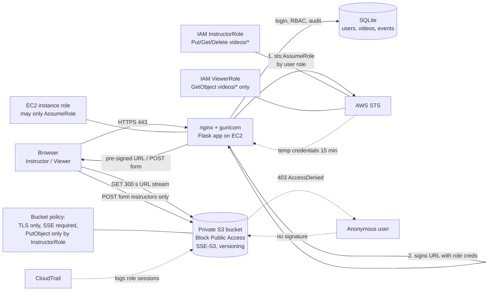

# Solution architecture

Draw the same picture in draw.io for the report (use the AWS icon set) – this file is the blueprint.

## Request flows
**Stream:** Viewer logs in → `/watch/ID` → app assumes ViewerRole → signs GET URL (300 s) → browser streams from S3 → URL dies after 5 min (the player asks for a fresh one if the user is still authorised).
**Upload (any size, chunked):** Instructor → `/api/upload/init` (RBAC + type/size checks, S3 `CreateMultipartUpload` with SSE-S3) → browser requests one short-lived pre-signed `UploadPart` URL per 8 MB chunk and PUTs it directly to S3 (3 in parallel, retries) → `/api/upload/complete` assembles the parts and verifies size, encryption and real MP4/WebM bytes → video becomes visible. Cancel/failure → `AbortMultipartUpload`.
**Forgot password:** user enters e-mail → signed single-use token (30 min) → link sent through Amazon SES (EC2 role has `ses:SendEmail`) → new password stored hashed; the old link stops working.
**Attack paths blocked:** anonymous object URL (403), Viewer forged upload (403 from IAM and bucket policy), tampered/expired URL (403), plain-HTTP access (403), wrong encryption algorithm (403), `.exe` renamed to `.mp4` (rejected by content check), declared size ≠ uploaded size (rejected).
